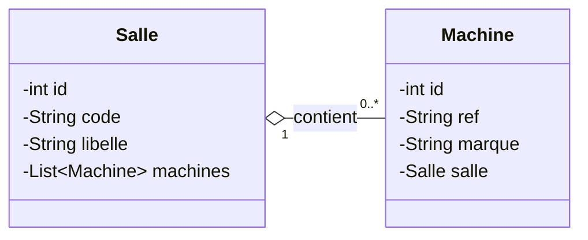

# 🎓 TP Hibernate : Gestion de la Persistance des Données avec JPA & MySQL


Ce projet a pour objectif de concevoir et implémenter une architecture de persistance objet-relationnelle (ORM) robuste basée sur **Hibernate 5** et **MySQL / MariaDB**, dans un cadre d'application Java d'entreprise.

---

## 🎯 Objectifs d'Apprentissage

- Comprendre le fonctionnement d'un **ORM (Object-Relational Mapping)**.
- Configurer Hibernate avec **Maven** et le fichier de configuration standard `hibernate.cfg.xml`.
- Mettre en place une **architecture en couches** standard (Entités, DAO générique, Services, Tests).
- Gérer les **relations bidirectionnelles** (`@OneToMany` et `@ManyToOne`).
- Maîtriser le **langage de requêtes HQL** (Hibernate Query Language) avec requêtes paramétrées.
- Sécuriser les écritures par une gestion rigoureuse des **transactions et du Rollback**.
- Valider la logique métier et CRUD avec **JUnit 5**.

---

## 🏗 Architecture du Projet

Le projet adopte une séparation stricte des responsabilités en couches :

```
TP4_LAB4/
├── pom.xml                                    # Configuration Maven & dépendances
├── README.md                                  # Rapport et documentation du projet
└── src/
    ├── main/
    │   ├── java/
    │   │   ├── dao/
    │   │   │   ├── IDao.java                  # Interface générique CRUD
    │   │   │   ├── SalleDao.java              # DAO Hibernate pour Salle
    │   │   │   └── MachineDao.java            # DAO Hibernate pour Machine (+ HQL)
    │   │   ├── entities/
    │   │   │   ├── Salle.java                 # Entité JPA Salle (OneToMany)
    │   │   │   └── Machine.java               # Entité JPA Machine (ManyToOne)
    │   │   ├── services/
    │   │   │   ├── SalleService.java          # Couche Service Salle
    │   │   │   └── MachineService.java        # Couche Service Machine
    │   │   ├── test/
    │   │   │   └── MainTest.java              # Classe principale de démonstration
    │   │   └── util/
    │   │       └── HibernateUtil.java         # Singleton SessionFactory thread-safe
    │   └── resources/
    │       └── hibernate.cfg.xml              # Configuration de connexion Hibernate
    └── test/
        └── java/
            └── services/
                ├── SalleServiceTest.java      # Tests JUnit 5 pour SalleService
                └── MachineServiceTest.java    # Tests JUnit 5 (CRUD, HQL, Rollback)
```

---

## 🧩 Modélisation & Relations JPA

La relation modélisée est une association bidirectionnelle **Un-à-Plusieurs** (Une `Salle` contient plusieurs `Machine`s) :



- **Côté Propriétaire (`Machine`)** :
  ```java
  @ManyToOne
  @JoinColumn(name = "salle_id")
  private Salle salle;
  ```
- **Côté Inverse (`Salle`)** :
  ```java
  @OneToMany(mappedBy = "salle", cascade = CascadeType.ALL, fetch = FetchType.LAZY)
  private List<Machine> machines = new ArrayList<>();
  ```

---

## 🛡 Gestion Transactionnelle & Bonnes Pratiques

Pour garantir l'intégrité référentielle et éviter les états incohérents dans la base de données, chaque opération d'écriture respecte le pattern **Transaction avec Rollback systématique** :

```java
Transaction tx = null;
try (Session session = HibernateUtil.getSessionFactory().openSession()) {
    tx = session.beginTransaction();
    // Opérations de persistance (save / update / delete)
    tx.commit();
} catch (Exception e) {
    if (tx != null) tx.rollback();
    throw new RuntimeException("Erreur transactionnelle : " + e.getMessage(), e);
}
```

Ce comportement est rigoureusement testé et validé dans [`MachineServiceTest.java`](file:///d:/DGSI/JEE/CR2/TP4_LAB4/src/test/java/services/MachineServiceTest.java) (`testTransactionRollbackOnError`).

---

## 📸 Extraits des Résultats & Captures d'Écran

Toutes les captures d'écran des résultats sont situées dans le dossier [`src/`](file:///d:/DGSI/JEE/CR2/TP4_LAB4/src).

### 1. Exécution de `MainTest` : Recherche par Marque (HQL)

L'application principale `test.MainTest` est exécutée via la commande Maven :
```bash
mvn compile exec:java "-Dexec.mainClass=test.MainTest"
```

Cette classe persiste des salles et des machines, puis exécute la méthode HQL paramétrée `findByMarque` :

```java
String hql = "FROM Machine m JOIN FETCH m.salle WHERE m.marque = :marque";
```

#### A. Recherche des machines de marque 'Dell' (`findByMarque`)


---

#### B. Recherche des machines de marque 'HP' (`findByMarque`)


---

### 2. Validation par Tests Unitaires (`mvn test`)

Les tests unitaires couvrent :
1. `SalleServiceTest.testCreateSalle` : Validation de l'insertion d'une salle.
2. `MachineServiceTest.testCreateAndFindByMarque` : Validation de l'insertion et de la requête HQL `findByMarque`.
3. `MachineServiceTest.testCreateMultipleTransaction` : Validation de l'insertion en lot dans une seule transaction.
4. `MachineServiceTest.testTransactionRollbackOnError` : Validation du déclenchement du `rollback()` et de l'exception `RuntimeException`.

Commande exécutée :
```bash
mvn test
```

Résultat : **4 tests exécutés avec succès (0 échecs, 0 erreurs) - BUILD SUCCESS**.


---

### 3. État de la Base de Données dans phpMyAdmin

#### A. Vue d'ensemble de la base de données `db_tp_hibernate`
Les tables `salles` et `machines` sont correctement créées et alimentées.


---

#### B. Table `salles`
Contient l'ensemble des salles insérées avec leur `code` et leur `libelle` :


---

#### C. Table `machines`
Contient les machines enregistrées avec la clé étrangère `salle_id` faisant référence à la table `salles` :


---

## 📌 Conclusion

Ce TP a permis de valider avec succès :
- La configuration complète d'un projet Java avec **Hibernate 5** et **MySQL**.
- La mise en œuvre des relations bidirectionnelles avec gestion du cycle de vie des entités.
- L'utilisation des requêtes HQL paramétrées pour extraire des données avec jointure optimisée (`JOIN FETCH`).
- La sécurisation transactionnelle avec gestion explicite du `commit` et `rollback`.
- La couverture de test avec **JUnit 5** garantissant la conformité et la robustesse de l'application.
